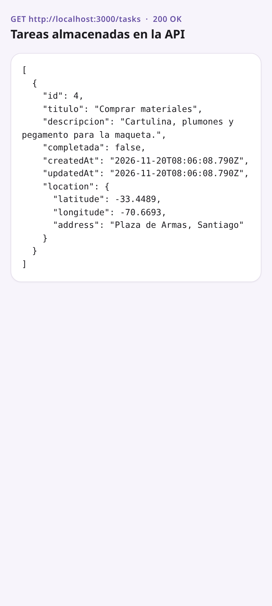

# Evaluacion 1 DESARROLLO DE APLICACIONES MÓVILES
**Alumno:** Luis Hernandez.
**Profesor:** Boris Belmar.
**Institución:** IPSS.
**Entrega:** lo nuevo respecto de la parte 1 (foto, GPS, permisos, persistencia y sincronización).

La parte 1 ya permitía listar, crear, editar, buscar, completar y eliminar tareas. Ese recorrido, con sus capturas, quedó en [docs/readmev1.md](docs/readmev1.md) (`imgs/imgsv1/`). Aquí documento solo lo que se suma: foto, ubicación, permisos, guardado en el dispositivo y envío a la API.

| # | Requisito | Cómo quedó |
|---|-----------|------------|
| RF6 | Capturar imagen | En el formulario, **Tomar foto** abre la cámara y **Galería** permite elegir una o varias imágenes. Cada foto se ve en miniatura y se puede quitar. En la lista, un chip abre la foto. |
| RF7 | Registrar ubicación | Al guardar una tarea nueva se piden latitud y longitud. Si el GPS devuelve una dirección, se guarda; el usuario también puede escribirla. La tarjeta muestra un chip con ícono `map-marker`. |
| RF8 | Permisos | Cámara y galería se piden al tocar el botón. La ubicación se pide solo al guardar una tarea nueva. Si se niegan, un aviso lo explica y la tarea se guarda igual. |
| RF9 | Almacenamiento local | `AsyncStorage` guarda el arreglo de tareas. Al abrir la app se vuelve a cargar, también sin conexión. |

## Estructura de archivos

```
EVU1_HERNANDEZ_LUIS/
├── index.ts          # registerRootComponent(App)
├── App.tsx           # Proveedores (SafeArea, Paper, Tasks) y navegación en pila
├── app.json          # Expo y plugins de cámara y ubicación (textos en español)
├── package.json      # Dependencias, script test y preset jest-expo
├── jest.setup.js     # Simula AsyncStorage y NetInfo
├── assets/ · imgs/   # Íconos/splash y capturas nuevas (las de la parte 1 están en imgs/imgsv1)
├── __tests__/        # cámara, GPS, almacenamiento y formulario
└── src/
    ├── components/   # TaskItem, Header, PrimaryButton, PhotoPicker
    ├── context/      # TasksContext.tsx: estado global, hydrate/persist
    ├── screens/      # TaskListScreen.tsx, TaskFormScreen.tsx
    ├── services/     # camera.ts, location.ts, storage.ts (y cola/API)
    ├── theme/        # theme.ts: paleta y tema MD3
    └── types/        # Task.ts, navigation.ts
```

- `index.ts`: Punto de entrada (`"main"` en `package.json`).
- `src/components/`: Componentes visuales por props. `PhotoPicker` arma los botones de foto y las miniaturas. `TaskItem` muestra el chip de fotos y el de ubicación.
- `src/context/TasksContext.tsx`: Fuente de datos. Al montar llama `loadTasks()` y, cuando el estado ya está hidratado, persiste cada cambio con `saveTasks()`.
- `src/screens/`: Una pantalla por ruta; leen el estado con `useTasks()`. No importan `expo-*` ni `AsyncStorage`.
- `src/services/`: Único lugar que habla con la cámara, el GPS y el almacenamiento. Las pruebas simulan estos módulos, no los plugins.
- `src/theme/theme.ts`: `palette` (estilos) y `theme` (para `PaperProvider`).
- `src/types/`: `Task` ahora incluye `photoUris?` y `location?`.

```ts
export type Task = {
  id: string;
  titulo: string;
  descripcion: string;
  completada: boolean;
  createdAt: string;
  photoUris?: string[];
  location?: {
    latitude: number;
    longitude: number;
    address?: string;
  };
};
```

La galería puede devolver varias fotos, así que el modelo usa `photoUris` (arreglo). Si en el almacenamiento queda una tarea vieja con un solo `photoUri`, `loadTasks` la lee como lista de un elemento.

## Conceptos fundamentales de React Native

- **Arquitectura:** Corre en el motor JavaScript y cada `<View>`/`<Text>` se convierte en un componente nativo real, sin HTML ni navegador. Uso React Native 0.88 con Expo SDK 58, compatibles con la nueva arquitectura (JSI, Fabric, TurboModules).
- **Expo:** Expo Go y librerías nativas (`expo-image-picker`, `expo-location`, `expo-status-bar`). Los permisos se declaran en `app.json` con el plugin de cada librería, con el texto en español que ve el usuario.
- **Componentes:** Funciones que devuelven la UI. Uso nativos (`View`, `Image`, `FlatList`, `Pressable`), de Paper (`Card`, `TextInput`, `Snackbar`, `ActivityIndicator`, `Icon`) y propios (`TaskItem`, `PhotoPicker`).
- **JSX:** Sintaxis tipo HTML con expresiones `{}` (p. ej., `{isEditing ? 'Editar tarea' : 'Nueva Tarea'}` en `TaskFormScreen.tsx`).
- **Props:** Datos de solo lectura del padre al hijo, tipados (`PhotoPicker` recibe `uris`, `onChange` y `onNotice`).
- **Estado:** Global en `TasksContext.tsx` (tareas y feedback) y local en el formulario (`titulo`, `photoUris`, `address`, `locating`, `notice`). Siempre lo actualizo de forma inmutable.
- **Hooks:** `useState`, `useContext`, `useCallback`, `useMemo`, `useEffect` (hidratar al abrir y persistir después) y `useRef` (cadena de guardados y deshacer).
- **Permisos:** No se piden al abrir la app. `takePhoto` y `pickFromGallery` los piden al tocar el botón. `getCurrentLocation` los pide al guardar una tarea nueva. En Android, además, pido el permiso nativo con `PermissionsAndroid` antes del de Expo, porque Expo Go a veces no muestra el diálogo del sistema.
- **Cámara y GPS:** `expo-image-picker` lanza la cámara o la galería y devuelve `assets[].uri`. `expo-location` lee la posición con precisión `Balanced` y, si puede, hace *reverse geocoding*. Si el geocodificado falla, igual guardo latitud y longitud.
- **AsyncStorage:** Guarda un string bajo la clave `tasks`. `saveTasks` serializa el arreglo y `loadTasks` lo parsea. Un JSON roto, un valor que no es arreglo o un ítem inválido no tiran la app: se descarta lo inválido y, si no queda nada usable, se devuelve `[]`.
- **Navegación:** React Navigation con *native stack*; rutas tipadas en `src/types/navigation.ts`. Para editar navego con `navigate('TaskForm', { taskId })` y vuelvo con `goBack()`.

El servicio de cámara no lanza: devuelve las uris o un motivo, y la UI decide el aviso.

```ts
// src/services/camera.ts
export type PhotoCapture =
  | { uris: string[] }
  | { uris: null; reason: 'denied' | 'cancelled' | 'error' };
```

## Patrones de diseño aplicados

- **Componentes y composición:** `App` compone proveedores y navegación. El formulario compone `PhotoPicker` sin saber cómo se abre la cámara.
- **Contenedor / presentación:** `TaskFormScreen` pide la ubicación y arma el `TaskInput`. `PhotoPicker` y `TaskItem` solo reciben datos y callbacks.
- **Context / Provider:** `TasksProvider` envuelve la navegación. Al montar hidrata desde `loadTasks`; un `useEffect` posterior persiste `tasks` cuando `hydrated` ya es verdadero, para no pisar el almacenamiento con el arreglo vacío inicial.
- **Capa de servicios:** Pantallas y contexto no importan `expo-image-picker`, `expo-location` ni `AsyncStorage`. Todo pasa por `src/services/`. Las pruebas hacen `jest.mock` de esos tres archivos (o de las librerías, en las pruebas del servicio).
- **Resultado en vez de excepción:** Permiso negado, cancelación y fallo del hardware devuelven `null` más un motivo. El formulario sigue y guarda la tarea.
- **Flujo unidireccional:** Los datos bajan (contexto → lista → `TaskItem`) y los eventos suben (`onChange` de las fotos → estado local → `addTask` / `updateTask`).
- **Custom hook `useTasks`:** Encapsula `useContext` y lanza si se usa fuera de `TasksProvider`.

## Decisiones de diseño de UI (Material Design 3)

- **Jerarquía:** `titleLarge` para la cabecera, `titleMedium` para el título de la tarea y `bodyMedium` (`onSurfaceVariant`, 2 líneas) para la descripción. La foto y la ubicación van en chips debajo, para no competir con el título.
- **Foto:** Miniaturas de 96 × 96 dp, `resizeMode="cover"` y radio 8, en una fila que hace wrap con separación de 8 dp. El botón de quitar queda arriba a la derecha de cada miniatura. **Tomar foto** y **Galería** ocupan el ancho a medias, con `minHeight` 48 e íconos `camera` e `image-multiple`.
- **Ubicación:** Campo opcional con ícono `map-marker`. Mientras el GPS responde, un `ActivityIndicator` y el texto **Obteniendo ubicación…** sustituyen el silencio, y **Guardar tarea** queda deshabilitado para no disparar dos lecturas.
- **Lista:** Chip de fotos (`image`) que abre un modal con la imagen a `cover`. Si hay varias, flechas y un contador `1 / N`. Chip de ubicación sobre `secondaryContainer`. Si no hay dirección, el chip muestra latitud y longitud con 5 decimales.
- **Permisos:** El `Snackbar` del formulario dura 4 s. Cámara denegada: **Permiso de cámara denegado. La tarea se puede guardar sin foto.** Galería denegada: el mismo aviso, con "galería". GPS denegado, ya en la lista: **Tarea guardada sin ubicación: permiso denegado.** Si el GPS falla sin ser un rechazo: **Tarea guardada sin ubicación.**
- **Contraste y tacto:** Se mantienen los pares WCAG AA de la parte 1 (`onSurface`/`surface` 16,3:1, blanco/`primary` 9,4:1) y las áreas de 48 dp. Cancelar la cámara o la galería no muestra aviso y no cambia las fotos ya elegidas.
- **Colores (`src/theme/theme.ts`):** `primary #4F378A`, `surface #FEF7FF`, `surfaceContainerLowest #FFFFFF`, `onSurface #1D1A22`, `secondaryContainer` para el chip de mapa, `tertiary #910809` para eliminar, `error #BA1A1A` para la validación.

## Componentes de UI principales

| Componente | Origen | Dónde / para qué |
|---|---|---|
| `PaperProvider` | React Native Paper | `App.tsx`: tema MD3 e íconos |
| `NavigationContainer`, `Stack.Navigator` | React Navigation | `App.tsx`: pila lista ↔ formulario |
| `FlatList` | React Native | `TaskListScreen`: lista virtualizada |
| `Card` | React Native Paper | `TaskItem`: tarjeta de cada tarea |
| `TextInput` + `HelperText` | React Native Paper | Título, descripción y dirección |
| `Image` | React Native | Miniatura del formulario y visor de la lista |
| `ActivityIndicator` | React Native Paper | Espera del GPS al crear |
| `Snackbar` | React Native Paper | Avisos de permiso, guardado y eliminación |
| `PhotoPicker` | Propio | Cámara, galería, miniaturas y quitar foto |
| `TaskItem` | Propio | Tarjeta, chip de fotos, chip `map-marker` y modal |

# To-Do List

Sobre la lista de la parte 1, cada tarea nueva puede llevar fotos y la ubicación del momento en que se guarda. Esas dos cosas son opcionales: si el permiso se niega, la tarea se guarda igual.

Todo queda primero en el dispositivo. Con red, el ícono de sincronizar envía el cambio a la API y la tarjeta pasa a sincronizada. Sin red, la barra superior marca **Sin red** y el aviso explica que hay que sincronizar al volver la conexión.

## Cómo ejecutarla

Requiere Node.js LTS y [Expo Go](https://expo.dev/go) actualizado (SDK 58). La API y Postgres solo hacen falta para sincronizar; la parte 2 (foto, GPS y almacenamiento) funciona sin ellas.

```bash
npm install
npx expo start
npx tsc --noEmit
npm test
```

En el celular, la cámara, la galería y el GPS hay que probarlos en un dispositivo, no en el emulador web. Los textos de permiso salen de los plugins de `app.json`.

Para la API, además: Postgres, `cp .env.example .env` con la IP del computador (no `localhost`), y en `api/` los scripts `npm install`, `npm run migrate` y `npm run dev`.

## Lo nuevo en pantalla

El alta, la búsqueda, el completado y el borrado con deshacer siguen como en la parte 1. Las capturas de abajo son solo de foto, GPS, permisos y sincronización.

### Formulario con foto y ubicación

Debajo de la descripción aparece **Imagen o comprobante (opcional)**. Sin foto dice **Agregar foto o captura**; con una, muestra la miniatura y la cruz para quitarla. **Tomar foto** y **Galería** piden el permiso en ese momento. El campo **Ubicación (opcional)** deja escribir una dirección antes de guardar.


### Permiso de cámara

Al tocar **Tomar foto**, Android pregunta si Expo Go puede tomar fotos. **No permitir** no bloquea el formulario: la tarea se puede guardar sin imagen. Cancelar el capturador tampoco cambia las fotos que ya estaban.


### Permiso de ubicación

El GPS no se consulta al abrir la pantalla. Se pide al pulsar **Guardar tarea**, y solo si el título es válido. El diálogo ofrece ubicación precisa o aproximada.


### Mientras llega el GPS

Con el permiso concedido, el formulario muestra **Obteniendo ubicación…** y deshabilita **Guardar tarea** para no lanzar dos lecturas. La dirección escrita, si hay una, se conserva.


Cuando el geocodificado responde, el campo queda con esa dirección (aquí, Plaza de Armas, Santiago) y el botón vuelve a estar activo. Si el usuario ya había escrito un texto, ese texto reemplaza al del GPS. Si falla solo el geocodificado, igual se guardan latitud y longitud.


### Permiso denegado

Si se niega la ubicación, la tarea se crea igual y el aviso dice **Tarea guardada sin ubicación: permiso denegado.** La tarjeta no lleva chip de mapa. Lo mismo aplica a la foto: se guarda sin `photoUris`.


### Tarea con foto y mapa

Con permiso, la lista muestra lo nuevo en la tarjeta: el chip **1 foto adjunta** y el chip `map-marker` con la dirección. Arriba, **1 pendiente** indica que el cambio todavía no llegó a la API. El aviso es **Tarea guardada**.


Tocar el chip de la foto abre el visor. Si hay varias, las flechas y el contador `1 / 1` recorren el arreglo.


### Editar

El lápiz abre la misma pantalla con el título, la descripción, la miniatura y la dirección. Se puede quitar la foto, tomar otra o cambiar el texto de la ubicación. **Actualizar tarea** no vuelve a leer el GPS: conserva latitud y longitud.


### Sin red

Sin conexión la lista sigue usable. La píldora de la barra pasa a **Sin red · 2** y el `Snackbar` dice **Sin conexión. La tarea se guardó en este dispositivo; sincronízala cuando vuelva la conexión.** El ícono de sincronizar de cada tarjeta pendiente queda en flechas, sin el visto de enviada. Las coordenadas ya guardadas siguen en el chip.


### Sincronizada

Con red, ese mismo ícono envía la tarea. Al terminar, el aviso es **Tarea sincronizada** y el ícono muestra el visto. Si no hay dirección escrita, el chip muestra latitud y longitud. **1 pendiente** sigue contando las que aún no salieron.


### En la API

`GET /tasks` devuelve la tarea ya persistida en PostgreSQL, con `location.latitude`, `location.longitude` y `location.address`. La foto no viaja como archivo: a la API se manda solo la primera `photo_uri`, como texto.



## Pruebas

`npm test` usa Jest con el preset `jest-expo`. `jest.setup.js` simula AsyncStorage. Las pruebas de periféricos simulan `expo-image-picker` y `expo-location`; las del formulario simulan `src/services/camera`, `location` y `storage`, así la pantalla no depende del hardware.

| Archivo | Qué verifica |
|---|---|
| `__tests__/camera.test.ts` | Con permiso, `takePhoto` y `pickFromGallery` devuelven las uris. Denegado o cancelado devuelve `null` y no lanza. Un fallo de la cámara devuelve `reason: 'error'`. La galería conserva todas las fotos elegidas. |
| `__tests__/location.test.ts` | Con permiso devuelve latitud, longitud y dirección. Sin dirección formateada arma una con calle, ciudad y región. Permiso negado o GPS caído no lanzan y no devuelven ubicación. Si falla solo el geocodificado, igual devuelve las coordenadas. |
| `__tests__/storage.test.ts` | `saveTasks` y `loadTasks` recuperan las mismas tareas, con fotos y ubicación. JSON corrupto o un valor que no es arreglo devuelve `[]`. Un `photoUri` antiguo se lee como `photoUris`. Los ítems inválidos se descartan y el resto se conserva. |
| `__tests__/TaskFormScreen.test.tsx` | La tarea guarda la foto tomada. Permiso de cámara denegado muestra el aviso y guarda sin foto. Cancelar no cambia las fotos. Se puede quitar una foto al editar. Con GPS concedido la tarea nueva guarda la ubicación y se ve el indicador de carga. Con GPS negado o con error se crea igual, sin `location`, y el aviso corresponde. Sin título no se llama a `getCurrentLocation`. |

## Tecnologías

- Expo SDK 58 y React Native 0.88
- TypeScript
- React Navigation
- React Native Paper, tema claro de Material Design 3
- `expo-image-picker` y `expo-location`, usados solo desde `src/services/`
- `@react-native-async-storage/async-storage`
- Jest, `jest-expo` y React Native Testing Library (`npm test`)

## ¿Por qué React Native con Expo?

Elegí React Native con Expo porque ya lo había usado para desarrollar un Sudoku y la experiencia me dejó con ganas de seguir aprendiéndolo. Me gustó poder crear una aplicación y probarla al instante en el celular, a diferencia de Java, donde hay que esperar la compilación, mover e instalar el APK, y repetir todo el proceso cada vez que algo falla o quiero hacer un cambio. En esta parte eso se nota más: la cámara, el GPS y los permisos se prueban en el mismo teléfono, sin armar un proyecto nativo aparte.
