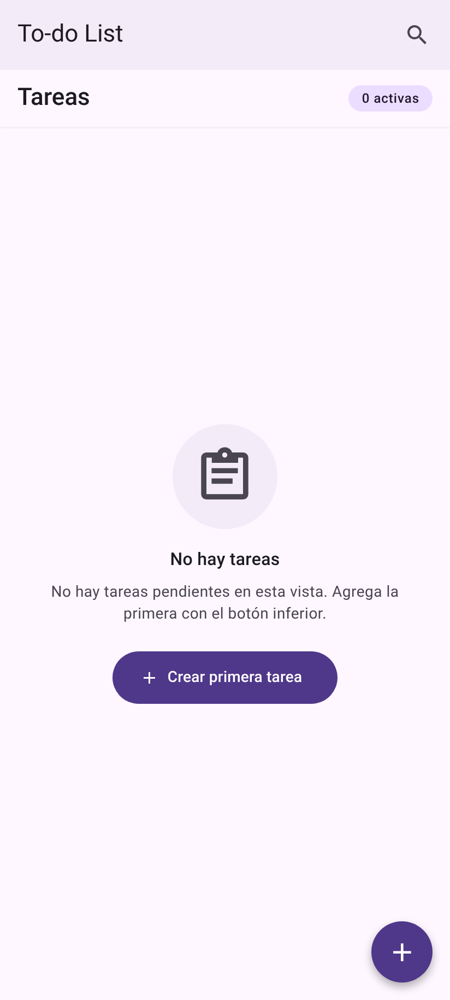

# Evaluacion 1 DESARROLLO DE APLICACIONES MÓVILES
**Alumno:** Luis Hernandez.
**Profesor:** Boris Belmar.
**Institución:** IPSS.


## Estructura de archivos

```
EVU1_HERNANDEZ_LUIS/
├── index.ts          # registerRootComponent(App)
├── App.tsx           # Proveedores (SafeArea, Paper, Tasks) y navegación en pila
├── app.json          # Configuración de Expo
├── package.json      # Dependencias y scripts
├── assets/ · imgs/   # Íconos/splash y capturas del README
└── src/
    ├── components/   # TaskItem, Header, PrimaryButton
    ├── context/      # TasksContext.tsx: estado global + hook useTasks
    ├── screens/      # TaskListScreen.tsx, TaskFormScreen.tsx
    ├── theme/        # theme.ts: paleta y tema MD3
    └── types/        # Task.ts, navigation.ts
```

- `index.ts`: Punto de entrada (`"main"` en `package.json`).
- `src/components/`: Componentes visuales por props. `TaskItem` se usa en la lista; `Header` y `PrimaryButton` quedan disponibles para reutilizar.
- `src/context/TasksContext.tsx`: Fuente de datos (`addTask`, `updateTask`, `toggleCompleted`, `removeTask`, `restoreTask`, `feedback`).
- `src/screens/`: Una pantalla por ruta; leen el estado con `useTasks()`.
- `src/theme/theme.ts`: `palette` (estilos) y `theme` (para `PaperProvider`).
- `src/types/`: Tipos compartidos (`Task`, `TaskInput`, `RootStackParamList`).

## Conceptos fundamentales de React Native

- **Arquitectura:** Corre en el motor JavaScript y cada `<View>`/`<Text>` se convierte en un componente nativo real, sin HTML ni navegador. Uso React Native 0.88 con Expo SDK 58, compatibles con la nueva arquitectura (JSI, Fabric, TurboModules).
- **Expo:** Expo Go y librerías como `expo-status-bar` y `@expo/vector-icons`.
- **Componentes:** Las funciones que devuelven la UI. Uso nativos (`View`, `FlatList`, `ScrollView`), de Paper (`Appbar`, `Card`, `TextInput`, `Button`, `IconButton`, `FAB`, `Dialog`, `Snackbar`, `Text`) y propios (`TaskItem`, `Header`, `PrimaryButton`).
- **JSX:** Sintaxis tipo HTML con expresiones `{}` (p. ej., `{isEditing ? 'Editar tarea' : 'Nueva Tarea'}` en `TaskFormScreen.tsx`).
- **Props:** Datos de solo lectura del padre al hijo, tipados (`TaskItemProps` en `TaskItem.tsx`).
- **Estado:** Global en `TasksContext.tsx` (tareas y feedback) y local en cada pantalla (formulario, búsqueda, tarea por eliminar). Siempre lo actualizo de forma inmutable:

```tsx
// src/context/TasksContext.tsx
const toggleCompleted = useCallback((id: string) => {
  setTasks((current) =>
    current.map((task) =>
      task.id === id ? { ...task, completada: !task.completada } : task,
    ),
  );
}, []);
```

- **Hooks:** `useState` (estado), `useContext` (dentro de `useTasks`), `useCallback` (acciones estables), `useMemo` (valor del contexto y `visibleTasks`), `useEffect` (mostrar el aviso y ocultarlo a los 4 s con `clearTimeout`), `useRef` (guardar la tarea eliminada para deshacer), `useIsFocused`, `useSafeAreaInsets` y mi hook `useTasks`.
- **Navegación:** React Navigation con *native stack*; rutas tipadas en `src/types/navigation.ts` (`TaskList` y `TaskForm: { taskId?: string }`). Para editar navego con `navigate('TaskForm', { taskId })` y vuelvo con `goBack()`.
- **Terminología:** Render/re-render, renderizado condicional (estado vacío / "Sin resultados" / lista), lista virtualizada (`FlatList` + `keyExtractor`), `StyleSheet` con Flexbox, componente controlado (`value` + `onChangeText`), Provider y safe area.

## Patrones de diseño aplicados

- **Componentes y composición:** `App` compone proveedores y navegación; la lista compone `FlatList` + `TaskItem` + `Separator`.
- **Contenedor / presentación:** `TaskListScreen` obtiene datos y decide las acciones; `TaskItem` solo recibe `task` y callbacks (`onToggle`, `onEdit`, `onDelete`), sin conocer contexto ni navegación.
- **Context / Provider:** `TasksProvider` envuelve la navegación en `App.tsx`; el valor se memoriza con `useMemo`.
- **Custom hook `useTasks`:** encapsula `useContext` y valida que se use dentro del proveedor:

```tsx
// src/context/TasksContext.tsx
export function useTasks(): TasksContextValue {
  const context = useContext(TasksContext);
  if (!context) {
    throw new Error('useTasks debe usarse dentro de TasksProvider');
  }
  return context;
}
```

- **Flujo unidireccional:** Los datos bajan (contexto → `visibleTasks` → `TaskItem`) y los eventos suben (`onToggle` → `toggleCompleted`). El contexto guarda `feedback` y la lista lo muestra y llama `clearFeedback()`.
- **Navegación en pila:** `createNativeStackNavigator<RootStackParamList>()`; `TaskFormScreen` sirve para crear y editar según llegue `taskId`. Paso solo el id, así siempre leo el dato actualizado (o muestro "No se encontró la tarea.").
- **Theming provider:** `theme.ts` extiende `MD3LightTheme` y se entrega con `PaperProvider`; los estilos usan los mismos tokens de `palette`.
- **Otros:** Tipado fuerte con TypeScript, deshacer (`useRef` + `restoreTask` en la misma posición) y `Portal` para que el `Dialog` se dibuje sobre toda la pantalla.

## Decisiones de diseño de UI (Material Design 3)

- **Jerarquía:** `titleLarge` para la cabecera, `titleMedium` para el título de la tarea y `bodyMedium` (`onSurfaceVariant`, 2 líneas) para la descripción; el FAB es la acción principal.
- **Balance:** Texto con `flex: 1` a la izquierda y acciones a la derecha (`TaskItem.tsx`); cabecera con `space-between`.
- **Contraste:** Todos los pares superan WCAG AA 4,5:1 (p. ej., `onSurface`/`surface` 16,3:1, blanco/`primary` 9,4:1). Lo completado también cambia de ícono, no solo de color.
- **Ritmo y grilla de 8 dp:** 12 dp entre tarjetas, 16 dp de padding, 24 dp entre campos; espacios múltiplos de 8 o 4 (con pequeñas excepciones para imitar el campo *outlined*).
- **Proporción:** Barra de 64 dp, FAB de 56 dp, campos de 56 dp, diálogo radio 28, tarjetas radio 12.
- **Tipografía:** Variantes de `Text` de Paper (`headlineSmall`, `titleLarge`, `bodyLarge`, `labelLarge`, `labelMedium`...).
- **Colores (`src/theme/theme.ts`):** `primary #4F378A` (FAB, Guardar, check), `surface #FEF7FF` (fondo), `surfaceContainerLowest #FFFFFF` (tarjetas), `onSurface #1D1A22` (textos), `tertiary #910809` (eliminar), `error #BA1A1A` (validación), `inverseSurface #322F37` (aviso).
- **Áreas táctiles:** `IconButton` de 48 × 48 dp, botones con `minHeight: 48`, `hitSlop={4}` en "Crear primera tarea" y `accessibilityLabel`.
- **Estado vacío:** `Avatar.Icon` con `clipboard-text-outline`, "No hay tareas" y botón para crear; con búsqueda sin resultados, `magnify-close` y "Sin resultados".
- **Confirmación:** `Dialog` antes de eliminar; "Eliminar" en `tertiary` para marcar la acción peligrosa.
- **Feedback:** `Snackbar` de Paper de 4 s ("Tarea guardada", "Tarea eliminada" + **Deshacer**); validación "El título es obligatorio." con `HelperText`; contador "N / 120"; `KeyboardAvoidingView` y `softwareKeyboardLayoutMode: "resize"` (`app.json`).

## Componentes de UI principales

| Componente | Origen | Dónde / para qué |
|---|---|---|
| `PaperProvider` | React Native Paper | `App.tsx`: tema MD3 e íconos |
| `SafeAreaProvider` / `useSafeAreaInsets` | safe-area-context | `App.tsx` y pantallas: respetar barras del sistema |
| `NavigationContainer`, `Stack.Navigator` | React Navigation | `App.tsx`: pila lista ↔ formulario |
| `StatusBar` | expo-status-bar | `App.tsx`: barra de estado oscura |
| `View`, `Text` (variant) | RN / Paper | Todo: diseño y tipografía M3 |
| `FlatList` | React Native | `TaskListScreen`: lista virtualizada |
| `Appbar.Header`, `Appbar.BackAction`, `Appbar.Content`, `Appbar.Action` | React Native Paper | Barra superior, volver y buscar |
| `Card` + `Card.Title` + `Card.Content` | React Native Paper | `TaskItem`: tarjeta de cada tarea |
| `Checkbox` | React Native Paper | `TaskItem`: marcar como realizada |
| `IconButton` | React Native Paper | `TaskItem`: editar y eliminar (48 × 48 dp) |
| `TextInput` (outlined) + `HelperText` | React Native Paper | `TaskFormScreen` y buscador: campos, validación y contador |
| `Button` | React Native Paper | Guardar, Descartar, Volver y botones del diálogo |
| `ScrollView` + `KeyboardAvoidingView` | React Native | `TaskFormScreen`: adaptarse al teclado |
| `FAB` | React Native Paper | `TaskListScreen`: crear tarea |
| `Portal` + `Dialog` | React Native Paper | `TaskListScreen`: confirmar eliminación |
| `Snackbar` | React Native Paper | Avisos con la acción Deshacer |
| `Avatar.Icon` | React Native Paper | Íconos de los estados vacíos |
| `TaskItem` | Propio | Tarjeta de cada tarea |
| `Header`, `PrimaryButton` | Propios sobre Paper | Se usan en ambas pantallas (`Appbar` y `Button`) |

# To-Do List

Aplicación móvil para registrar, buscar, editar y eliminar tareas pendientes. Cada tarea tiene título y descripción. El título es obligatorio.

La interfaz usa Material Design 3 (React Native Paper). Las tareas se guardan en memoria: al cerrar la aplicación se pierden.

## Cómo ejecutarla

Requiere Node.js LTS y [Expo Go](https://expo.dev/go) actualizado (SDK 58).

```bash
npm install
npx expo start
```

## Pantallas

### Inicio

Si no hay tareas, la lista muestra el estado vacío y el botón **Crear primera tarea**. El botón flotante **+** (`FAB`) abre el formulario.



### Crear tarea

El formulario pide el título (máximo 120 caracteres) y una descripción opcional. Los campos son `TextInput` con borde de React Native Paper y un contador de caracteres debajo.


Si el título está vacío, la tarea no se guarda: el campo se marca en rojo y `HelperText` muestra **El título es obligatorio.**


Al guardar, la app vuelve a la lista y el `Snackbar` muestra **Tarea guardada**. El contador indica cuántas tareas están activas.


### Lista de tareas

Cada tarea es una `Card` con su título, su descripción, una casilla para marcarla como realizada y los botones de editar y eliminar.


### Editar tarea

El ícono de lápiz abre la misma pantalla con los datos de la tarea. La cabecera dice **Editar tarea** y el botón dice **Actualizar tarea**.


Al guardar, la app vuelve a la lista y aparece el aviso **Tarea actualizada correctamente**.


### Marcar como realizada

La casilla de cada tarjeta cambia el estado. La tarea realizada aparece marcada y deja de contarse como activa, pero sigue visible en la lista.


### Buscar

La lupa de la barra superior abre el buscador. Filtra por título y descripción, sin distinguir mayúsculas ni acentos, y el contador pasa a mostrar los resultados.


Si ninguna tarea coincide, la app muestra el estado **Sin resultados**.


### Eliminar

El ícono de basurero abre un `Dialog` de confirmación. **Cancelar** cierra el diálogo y **Eliminar** quita la tarea.


Después de eliminar, el `Snackbar` muestra **Tarea eliminada** con la opción **Deshacer**.


Si tocas **Deshacer**, la tarea vuelve a su lugar en la lista.


## Tecnologías

- Expo SDK 58 y React Native
- TypeScript
- React Navigation
- React Native Paper, tema claro de Material Design 3
- Estado con `useState` y `useContext`

## ¿Por qué React Native con Expo?

Elegí React Native con Expo porque ya lo había usado para desarrollar un Sudoku y la experiencia me dejó con ganas de seguir aprendiéndolo. Me gustó poder crear una aplicación y probarla al instante en el celular, a diferencia de Java, donde hay que esperar la compilación, mover e instalar el APK, y repetir todo el proceso cada vez que algo falla o quiero hacer un cambio. En simples palabras, lo seleccioné para seguir aprendiendo este stack.