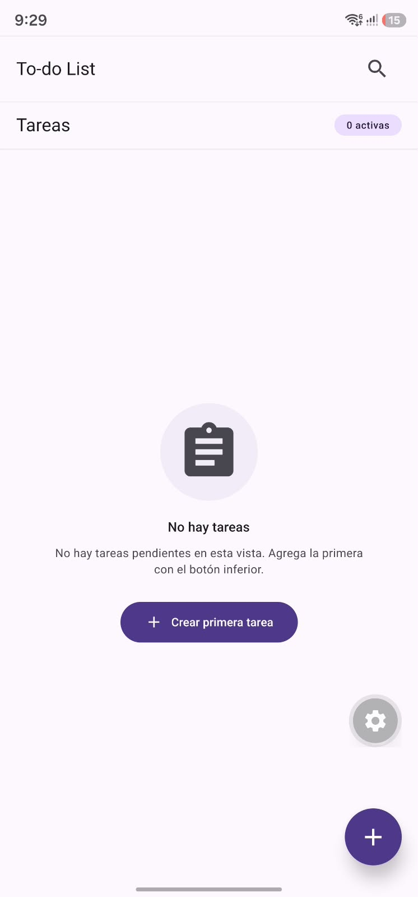

# Evaluacion 1 DESARROLLO DE APLICACIONES MÓVILES
**Alumno:** Luis Hernandez.
**Profesor:** Boris Belmar.
**Institución:** IPSS.

# To-Do List

Aplicación móvil para registrar, buscar, editar y eliminar tareas pendientes. Cada tarea tiene título y descripción. El título es obligatorio.

La interfaz usa Material Design 3 (React Native Paper). Las tareas se guardan en memoria: al cerrar la aplicación se pierden.

## Cómo ejecutarla

Requiere Node.js LTS y [Expo Go](https://expo.dev/go) actualizado (SDK 58).

```bash
npm install
npx expo start
```

## Pantallas

### Inicio

Si no hay tareas, la lista muestra el estado vacío y el botón para crear la primera. El botón **+** abre el formulario.



### Crear tarea

El formulario pide el título (máximo 120 caracteres) y una descripción opcional. Si el título está vacío, no se guarda y se muestra el error.


Al guardar, vuelve a la lista y aparece el aviso **Tarea guardada**. El contador indica cuántas tareas están activas.


### Editar tarea

El ícono de lápiz abre la misma pantalla con los datos de la tarea. La cabecera dice **Editar tarea** y el botón **Actualizar tarea**.


Al guardar, vuelve a la lista y aparece el aviso **Tarea actualizada correctamente**.


### Marcar como realizada

El círculo de cada tarjeta cambia el estado. La tarea realizada muestra una palomita y deja de contarse como activa. Sigue visible en la lista.


### Buscar

La lupa abre el buscador en la cabecera. Filtra por título y descripción, sin distinguir mayúsculas ni acentos. El contador pasa a mostrar los resultados.


### Eliminar

El ícono de basurero pide confirmación. **Cancelar** cierra el diálogo. **Eliminar** quita la tarea y muestra **Tarea eliminada**, con la opción **Deshacer**.


## Tecnologías

- Expo SDK 58 y React Native
- TypeScript
- React Navigation (pila: lista y formulario)
- React Native Paper, tema claro de Material Design 3
- Estado con `useState` y `useContext`
