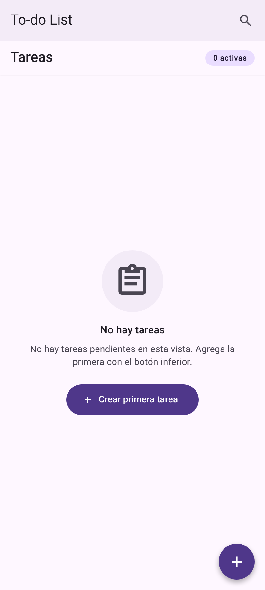

# Evaluacion 1 DESARROLLO DE APLICACIONES MÓVILES
**Alumno:** Luis Hernandez.
**Profesor:** Boris Belmar.
**Institución:** IPSS.
**Entrega:** parte 2 (cámara, GPS, almacenamiento local y pruebas).

La parte 1 ya permitía listar, crear, editar, buscar, completar y eliminar tareas con React Native Paper. Esta versión suma foto, ubicación y persistencia en el dispositivo, sin bloquear el guardado si falta un permiso.

| # | Requisito | Cómo quedó |
|---|-----------|------------|
| RF6 | Capturar imagen | En el formulario, **Tomar foto** abre la cámara y **Galería** permite elegir una o varias imágenes. Cada foto se ve en miniatura y se puede quitar. En la lista, un chip abre la foto. |
| RF7 | Registrar ubicación | Al guardar una tarea nueva se piden latitud y longitud. Si el GPS devuelve una dirección, se guarda; el usuario también puede escribirla. La tarjeta muestra un chip con ícono `map-marker`. |
| RF8 | Permisos | Cámara y galería se piden al tocar el botón. La ubicación se pide solo al guardar una tarea nueva. Si se niegan, un aviso lo explica y la tarea se guarda igual. |
| RF9 | Almacenamiento local | `AsyncStorage` guarda el arreglo de tareas. Al abrir la app se vuelve a cargar, también sin conexión. |

## Estructura de archivos

```
EVU1_HERNANDEZ_LUIS/
├── index.ts          # registerRootComponent(App)
├── App.tsx           # Proveedores (SafeArea, Paper, Tasks) y navegación en pila
├── app.json          # Expo y plugins de cámara y ubicación (textos en español)
├── package.json      # Dependencias, script test y preset jest-expo
├── jest.setup.js     # Simula AsyncStorage y NetInfo
├── assets/ · imgs/   # Íconos/splash y capturas del README
├── __tests__/        # cámara, GPS, almacenamiento y formulario
└── src/
    ├── components/   # TaskItem, Header, PrimaryButton, PhotoPicker
    ├── context/      # TasksContext.tsx: estado global, hydrate/persist
    ├── screens/      # TaskListScreen.tsx, TaskFormScreen.tsx
    ├── services/     # camera.ts, location.ts, storage.ts (y cola/API)
    ├── theme/        # theme.ts: paleta y tema MD3
    └── types/        # Task.ts, navigation.ts
```

- `index.ts`: Punto de entrada (`"main"` en `package.json`).
- `src/components/`: Componentes visuales por props. `PhotoPicker` arma los botones de foto y las miniaturas. `TaskItem` muestra el chip de fotos y el de ubicación.
- `src/context/TasksContext.tsx`: Fuente de datos. Al montar llama `loadTasks()` y, cuando el estado ya está hidratado, persiste cada cambio con `saveTasks()`.
- `src/screens/`: Una pantalla por ruta; leen el estado con `useTasks()`. No importan `expo-*` ni `AsyncStorage`.
- `src/services/`: Único lugar que habla con la cámara, el GPS y el almacenamiento. Las pruebas simulan estos módulos, no los plugins.
- `src/theme/theme.ts`: `palette` (estilos) y `theme` (para `PaperProvider`).
- `src/types/`: `Task` ahora incluye `photoUris?` y `location?`.

```ts
export type Task = {
  id: string;
  titulo: string;
  descripcion: string;
  completada: boolean;
  createdAt: string;
  photoUris?: string[];
  location?: {
    latitude: number;
    longitude: number;
    address?: string;
  };
};
```

La galería puede devolver varias fotos, así que el modelo usa `photoUris` (arreglo). Si en el almacenamiento queda una tarea vieja con un solo `photoUri`, `loadTasks` la lee como lista de un elemento.

## Conceptos fundamentales de React Native

- **Arquitectura:** Corre en el motor JavaScript y cada `<View>`/`<Text>` se convierte en un componente nativo real, sin HTML ni navegador. Uso React Native 0.88 con Expo SDK 58, compatibles con la nueva arquitectura (JSI, Fabric, TurboModules).
- **Expo:** Expo Go y librerías nativas (`expo-image-picker`, `expo-location`, `expo-status-bar`). Los permisos se declaran en `app.json` con el plugin de cada librería, con el texto en español que ve el usuario.
- **Componentes:** Funciones que devuelven la UI. Uso nativos (`View`, `Image`, `FlatList`, `Pressable`), de Paper (`Card`, `TextInput`, `Snackbar`, `ActivityIndicator`, `Icon`) y propios (`TaskItem`, `PhotoPicker`).
- **JSX:** Sintaxis tipo HTML con expresiones `{}` (p. ej., `{isEditing ? 'Editar tarea' : 'Nueva Tarea'}` en `TaskFormScreen.tsx`).
- **Props:** Datos de solo lectura del padre al hijo, tipados (`PhotoPicker` recibe `uris`, `onChange` y `onNotice`).
- **Estado:** Global en `TasksContext.tsx` (tareas y feedback) y local en el formulario (`titulo`, `photoUris`, `address`, `locating`, `notice`). Siempre lo actualizo de forma inmutable.
- **Hooks:** `useState`, `useContext`, `useCallback`, `useMemo`, `useEffect` (hidratar al abrir y persistir después) y `useRef` (cadena de guardados y deshacer).
- **Permisos:** No se piden al abrir la app. `takePhoto` y `pickFromGallery` los piden al tocar el botón. `getCurrentLocation` los pide al guardar una tarea nueva. En Android, además, pido el permiso nativo con `PermissionsAndroid` antes del de Expo, porque Expo Go a veces no muestra el diálogo del sistema.
- **Cámara y GPS:** `expo-image-picker` lanza la cámara o la galería y devuelve `assets[].uri`. `expo-location` lee la posición con precisión `Balanced` y, si puede, hace *reverse geocoding*. Si el geocodificado falla, igual guardo latitud y longitud.
- **AsyncStorage:** Guarda un string bajo la clave `tasks`. `saveTasks` serializa el arreglo y `loadTasks` lo parsea. Un JSON roto, un valor que no es arreglo o un ítem inválido no tiran la app: se descarta lo inválido y, si no queda nada usable, se devuelve `[]`.
- **Navegación:** React Navigation con *native stack*; rutas tipadas en `src/types/navigation.ts`. Para editar navego con `navigate('TaskForm', { taskId })` y vuelvo con `goBack()`.

El servicio de cámara no lanza: devuelve las uris o un motivo, y la UI decide el aviso.

```ts
// src/services/camera.ts
export type PhotoCapture =
  | { uris: string[] }
  | { uris: null; reason: 'denied' | 'cancelled' | 'error' };
```

## Patrones de diseño aplicados

- **Componentes y composición:** `App` compone proveedores y navegación. El formulario compone `PhotoPicker` sin saber cómo se abre la cámara.
- **Contenedor / presentación:** `TaskFormScreen` pide la ubicación y arma el `TaskInput`. `PhotoPicker` y `TaskItem` solo reciben datos y callbacks.
- **Context / Provider:** `TasksProvider` envuelve la navegación. Al montar hidrata desde `loadTasks`; un `useEffect` posterior persiste `tasks` cuando `hydrated` ya es verdadero, para no pisar el almacenamiento con el arreglo vacío inicial.
- **Capa de servicios:** Pantallas y contexto no importan `expo-image-picker`, `expo-location` ni `AsyncStorage`. Todo pasa por `src/services/`. Las pruebas hacen `jest.mock` de esos tres archivos (o de las librerías, en las pruebas del servicio).
- **Resultado en vez de excepción:** Permiso negado, cancelación y fallo del hardware devuelven `null` más un motivo. El formulario sigue y guarda la tarea.
- **Flujo unidireccional:** Los datos bajan (contexto → lista → `TaskItem`) y los eventos suben (`onChange` de las fotos → estado local → `addTask` / `updateTask`).
- **Custom hook `useTasks`:** Encapsula `useContext` y lanza si se usa fuera de `TasksProvider`.

## Decisiones de diseño de UI (Material Design 3)

- **Jerarquía:** `titleLarge` para la cabecera, `titleMedium` para el título de la tarea y `bodyMedium` (`onSurfaceVariant`, 2 líneas) para la descripción. La foto y la ubicación van en chips debajo, para no competir con el título.
- **Foto:** Miniaturas de 96 × 96 dp, `resizeMode="cover"` y radio 8, en una fila que hace wrap con separación de 8 dp. El botón de quitar queda arriba a la derecha de cada miniatura. **Tomar foto** y **Galería** ocupan el ancho a medias, con `minHeight` 48 e íconos `camera` e `image-multiple`.
- **Ubicación:** Campo opcional con ícono `map-marker`. Mientras el GPS responde, un `ActivityIndicator` y el texto **Obteniendo ubicación…** sustituyen el silencio, y **Guardar tarea** queda deshabilitado para no disparar dos lecturas.
- **Lista:** Chip de fotos (`image`) que abre un modal con la imagen a `cover`. Si hay varias, flechas y un contador `1 / N`. Chip de ubicación sobre `secondaryContainer`. Si no hay dirección, el chip muestra latitud y longitud con 5 decimales.
- **Permisos:** El `Snackbar` del formulario dura 4 s. Cámara denegada: **Permiso de cámara denegado. La tarea se puede guardar sin foto.** Galería denegada: el mismo aviso, con "galería". GPS denegado, ya en la lista: **Tarea guardada sin ubicación: permiso denegado.** Si el GPS falla sin ser un rechazo: **Tarea guardada sin ubicación.**
- **Contraste y tacto:** Se mantienen los pares WCAG AA de la parte 1 (`onSurface`/`surface` 16,3:1, blanco/`primary` 9,4:1) y las áreas de 48 dp. Cancelar la cámara o la galería no muestra aviso y no cambia las fotos ya elegidas.
- **Colores (`src/theme/theme.ts`):** `primary #4F378A`, `surface #FEF7FF`, `surfaceContainerLowest #FFFFFF`, `onSurface #1D1A22`, `secondaryContainer` para el chip de mapa, `tertiary #910809` para eliminar, `error #BA1A1A` para la validación.

## Componentes de UI principales

| Componente | Origen | Dónde / para qué |
|---|---|---|
| `PaperProvider` | React Native Paper | `App.tsx`: tema MD3 e íconos |
| `NavigationContainer`, `Stack.Navigator` | React Navigation | `App.tsx`: pila lista ↔ formulario |
| `FlatList` | React Native | `TaskListScreen`: lista virtualizada |
| `Card` | React Native Paper | `TaskItem`: tarjeta de cada tarea |
| `TextInput` + `HelperText` | React Native Paper | Título, descripción y dirección |
| `Image` | React Native | Miniatura del formulario y visor de la lista |
| `ActivityIndicator` | React Native Paper | Espera del GPS al crear |
| `Snackbar` | React Native Paper | Avisos de permiso, guardado y eliminación |
| `PhotoPicker` | Propio | Cámara, galería, miniaturas y quitar foto |
| `TaskItem` | Propio | Tarjeta, chip de fotos, chip `map-marker` y modal |

# To-Do List

Aplicación móvil para registrar, buscar, editar y eliminar tareas. El título es obligatorio (máximo 120 caracteres). Al crearla se pueden adjuntar fotos y, si el permiso está concedido, se guarda la ubicación.

Las tareas, las fotos y la ubicación quedan en el dispositivo con AsyncStorage y se cargan al abrir la app, también sin conexión. Negar un permiso no impide guardar.

Con `EXPO_PUBLIC_API_URL` apuntando a `api/`, cada alta, edición o borrado se encola y se envía al servidor al haber red. Sin esa URL la lista sigue funcionando en local. La API guarda una sola `photo_uri`: se envía la primera foto como texto, no el archivo.

## Cómo ejecutarla

Requiere Node.js LTS y [Expo Go](https://expo.dev/go) actualizado (SDK 58). La API y Postgres solo hacen falta para sincronizar; la parte 2 (foto, GPS y almacenamiento) funciona sin ellas.

```bash
npm install
npx expo start
npx tsc --noEmit
npm test
```

En el celular, la cámara, la galería y el GPS hay que probarlos en un dispositivo, no en el emulador web. Los textos de permiso salen de los plugins de `app.json`.

Para la API, además: Postgres, `cp .env.example .env` con la IP del computador (no `localhost`), y en `api/` los scripts `npm install`, `npm run migrate` y `npm run dev`.

## Pantallas

### Inicio

Si no hay tareas, la lista muestra el estado vacío y el botón **Crear primera tarea**. El botón flotante **+** abre el formulario.



### Crear tarea

El formulario pide el título y una descripción opcional. Debajo está el bloque **Imagen o comprobante (opcional)**: sin fotos muestra el llamado **Agregar foto o captura**; con fotos, las miniaturas. El campo **Ubicación (opcional)** deja escribir una dirección. Al pulsar **Guardar tarea**, si el título es válido, aparece **Obteniendo ubicación…** y después la app vuelve a la lista.


Si el título está vacío, la tarea no se guarda y tampoco se consulta el GPS. El campo se marca en rojo y `HelperText` muestra **El título es obligatorio.**


Al guardar con ubicación, el `Snackbar` muestra **Tarea guardada**.


### Foto

**Tomar foto** pide permiso de cámara y abre el capturador. **Galería** pide permiso de fotos y permite varias imágenes. Cada miniatura tiene **Quitar foto**. Si el permiso se niega, el `Snackbar` avisa y el resto del formulario sigue habilitado. Cancelar el capturador no agrega ni borra fotos.

### Ubicación

Solo las tareas nuevas consultan el GPS, y solo después de validar el título. Si el usuario escribió una dirección, ese texto reemplaza el que devuelva el geocodificado. Al editar no se vuelve a leer el GPS: se conservan latitud y longitud, y se puede cambiar el texto de la dirección. Sin permiso o si el GPS falla, la tarea se crea sin `location` y el aviso lo dice.

### Lista de tareas

Cada tarea es una `Card` con título, descripción, casilla de realizada y botones de editar y eliminar. Si tiene fotos, el chip dice **1 foto adjunta** o **N fotos adjuntas** y abre el visor. Si tiene ubicación, el chip `map-marker` muestra la dirección o las coordenadas.


### Editar tarea

El lápiz abre la misma pantalla con los datos, las fotos y la dirección. La cabecera dice **Editar tarea** y el botón **Actualizar tarea**. Se pueden agregar o quitar fotos. Guardar no pide ubicación de nuevo.


### Marcar como realizada

La casilla cambia el estado. La tarea realizada deja de contarse como activa y sigue en la lista. El cambio también se escribe en AsyncStorage.


### Buscar

La lupa filtra por título y descripción, sin distinguir mayúsculas ni acentos.


### Eliminar

El basurero abre un `Dialog`. **Eliminar** quita la tarea del estado y del almacenamiento. El `Snackbar` ofrece **Deshacer**, que la reinserta en la misma posición.


### Cerrar y volver a abrir

Al salir de la app las tareas siguen en AsyncStorage (clave `tasks`), incluidas `photoUris` y `location`. Al abrir, `TasksProvider` las carga antes de aceptar ediciones, así el primer render vacío no borra lo guardado. Sin red la lista sigue disponible.

## Pruebas

`npm test` usa Jest con el preset `jest-expo`. `jest.setup.js` simula AsyncStorage. Las pruebas de periféricos simulan `expo-image-picker` y `expo-location`; las del formulario simulan `src/services/camera`, `location` y `storage`, así la pantalla no depende del hardware.

| Archivo | Qué verifica |
|---|---|
| `__tests__/camera.test.ts` | Con permiso, `takePhoto` y `pickFromGallery` devuelven las uris. Denegado o cancelado devuelve `null` y no lanza. Un fallo de la cámara devuelve `reason: 'error'`. La galería conserva todas las fotos elegidas. |
| `__tests__/location.test.ts` | Con permiso devuelve latitud, longitud y dirección. Sin dirección formateada arma una con calle, ciudad y región. Permiso negado o GPS caído no lanzan y no devuelven ubicación. Si falla solo el geocodificado, igual devuelve las coordenadas. |
| `__tests__/storage.test.ts` | `saveTasks` y `loadTasks` recuperan las mismas tareas, con fotos y ubicación. JSON corrupto o un valor que no es arreglo devuelve `[]`. Un `photoUri` antiguo se lee como `photoUris`. Los ítems inválidos se descartan y el resto se conserva. |
| `__tests__/TaskFormScreen.test.tsx` | La tarea guarda la foto tomada. Permiso de cámara denegado muestra el aviso y guarda sin foto. Cancelar no cambia las fotos. Se puede quitar una foto al editar. Con GPS concedido la tarea nueva guarda la ubicación y se ve el indicador de carga. Con GPS negado o con error se crea igual, sin `location`, y el aviso corresponde. Sin título no se llama a `getCurrentLocation`. |

## Tecnologías

- Expo SDK 58 y React Native 0.88
- TypeScript
- React Navigation
- React Native Paper, tema claro de Material Design 3
- `expo-image-picker` y `expo-location`, usados solo desde `src/services/`
- `@react-native-async-storage/async-storage`
- Jest, `jest-expo` y React Native Testing Library (`npm test`)

## ¿Por qué React Native con Expo?

Elegí React Native con Expo porque ya lo había usado para desarrollar un Sudoku y la experiencia me dejó con ganas de seguir aprendiéndolo. Me gustó poder crear una aplicación y probarla al instante en el celular, a diferencia de Java, donde hay que esperar la compilación, mover e instalar el APK, y repetir todo el proceso cada vez que algo falla o quiero hacer un cambio. En esta parte eso se nota más: la cámara, el GPS y los permisos se prueban en el mismo teléfono, sin armar un proyecto nativo aparte.
